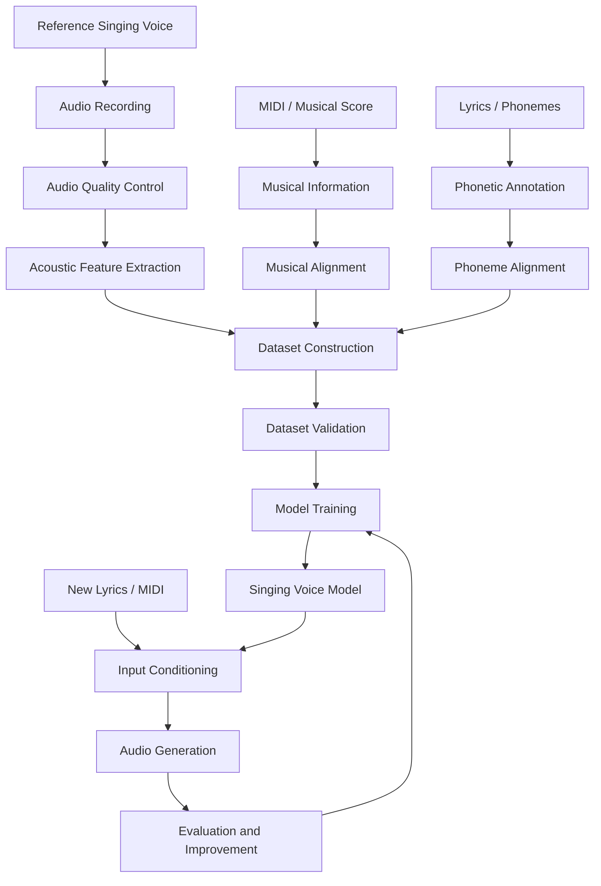
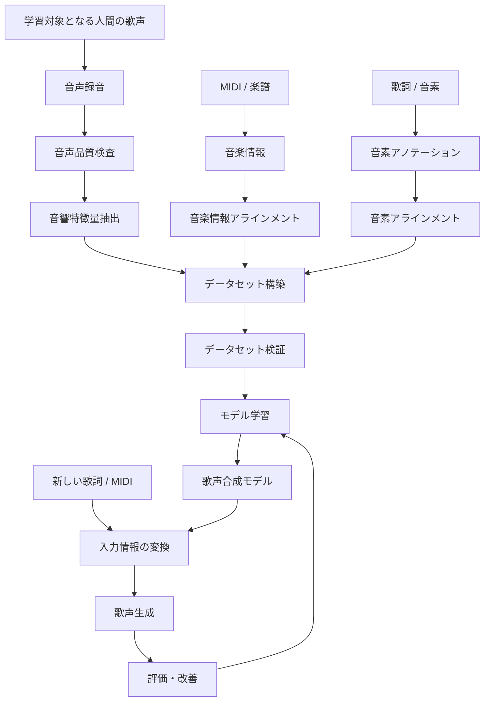

# RG-SingingAI(TBD)

<p align="center">
  <strong>Human Voice Reproduction through AI-Based Singing Voice Synthesis</strong>
</p>

<p align="center">
  A research and development project focused on reproducing the characteristics of human singing voices with high fidelity.
</p>

<p align="center">
  
  
  
  
</p>

<p align="center">
  <a href="#english">English</a> |
  <a href="#日本語">日本語</a>
</p>

---

# English

## 1. Overview

**RG-SingingAI** is an independent research and development project aiming to create an AI-based singing voice synthesis system capable of reproducing the acoustic and expressive characteristics of a human singing voice.

Unlike conventional approaches that primarily focus on generating intelligible singing from phonemes and musical notes, this project places particular emphasis on reproducing the individual characteristics of the original voice.

The ultimate goal is to create a model that can reproduce not only what a person sings, but also how that person sings.

### Core Objectives

- High-fidelity reproduction of individual vocal timbre.
- Accurate pitch and intonation reproduction.
- Natural phoneme transitions and pronunciation.
- Reproduction of breathiness and breathing behavior.
- Natural vibrato and pitch fluctuations.
- Reproduction of vocal dynamics and expressive characteristics.
- Preservation of individual singing styles.
- Natural and continuous vocal generation.

The project aims to investigate the combination of acoustic analysis, machine learning, neural networks, and signal processing to achieve these objectives.

---

## 2. Research Direction

The project is organized around several major technical areas.

### 2.1 Voice Recording and Dataset Construction

The first stage is to collect high-quality reference singing recordings.

The recorded audio is used as the primary training material and is associated with additional musical and phonetic information.

Planned and developed dataset components include:

- WAV audio recordings.
- Recording metadata.
- MIDI musical information.
- Lyrics and phoneme annotations.
- Pitch and timing information.
- Acoustic feature representations.
- Quality control information.
- Dataset partitioning and validation metadata.

The dataset must preserve the relationship between the original audio, musical information, and phonetic information.

### 2.2 Acoustic Analysis

Human singing contains considerably more information than fundamental frequency alone.

The project therefore investigates multiple acoustic characteristics.

| Feature | Research Purpose |
|---|---|
| Fundamental Frequency (F0) | Pitch and intonation |
| Spectral Envelope | Vocal timbre |
| Formants | Vocal resonance characteristics |
| Harmonic-to-Noise Ratio (HNR) | Voice periodicity and noise characteristics |
| Aperiodicity | Non-periodic vocal components |
| Breathiness | Breath-related vocal characteristics |
| RMS Energy | Vocal intensity |
| Log-Mel Spectrogram | Time-frequency representation |
| Vibrato | Periodic pitch modulation |
| Phoneme Transitions | Pronunciation and articulation |

These features are intended to provide complementary information for model training.

Some feature extraction methods are currently experimental approximations and require further validation.

### 2.3 Musical and Phonetic Alignment

The project uses musical and phonetic information to associate singing performances with their corresponding input conditions.

Relevant information includes:

- MIDI note numbers.
- Note onset and offset.
- MIDI velocity.
- Tempo.
- Time signatures.
- Lyrics.
- Phoneme labels.
- Phoneme start and end times.
- Audio frame timestamps.

An important distinction is maintained between MIDI timing and actual vocal timing.

Musical note boundaries do not necessarily correspond to phoneme boundaries or actual vocal onset.

### 2.4 Singing Voice Modeling

The long-term objective is to develop a neural network capable of learning the relationship between:

- Phonetic content.
- Musical pitch.
- Vocal characteristics.
- Acoustic features.
- Singing expression.
- Temporal behavior.

The model should eventually generate singing that preserves the characteristics of a reference voice while following new musical and phonetic input.

---

## 3. System Architecture

The overall development direction can be represented as follows.



This diagram represents the intended overall architecture, not a claim that every stage is already complete.

---

## 4. Main Components

### 4.1 RG Singing AI Recording Tool

A dedicated recording and dataset preparation application.

Its responsibilities include:

- Recording reference singing voices.
- MIDI-based recording support.
- Lyric display.
- Musical score visualization.
- Recording management.
- Audio quality inspection.
- Acoustic feature extraction.
- Dataset metadata generation.

The recording tool is developed as a separate component so that data collection and model development can evolve independently.

### 4.2 Acoustic Feature Analysis

A dedicated analysis pipeline for extracting and inspecting acoustic representations.

Research areas include:

- F0 estimation.
- Spectral analysis.
- Log-Mel feature extraction.
- Spectral envelope estimation.
- Formant analysis.
- Voice quality descriptors.
- Frame-level quality control.

### 4.3 Dataset Pipeline

A structured data preparation system.

Its responsibilities include:

- Annotation processing.
- Feature alignment.
- Dataset generation.
- Metadata validation.
- File integrity verification.
- Group-aware training and validation splitting.

### 4.4 Machine Learning

Experimental neural network components for singing voice modeling.

The current development direction includes phoneme-conditioned and MIDI-conditioned acoustic prediction.

Further development will focus on temporal modeling, vocal expression, and improved audio reconstruction.

---

## 5. Development Philosophy

RG-SingingAI follows several development principles.

**Accuracy over superficial functionality**

A feature is not considered complete simply because it produces output. Its accuracy and limitations must be evaluated.

**Preservation of original recordings**

Original recordings should remain available for re-analysis and reproducibility.

**Separation of reference data and estimated data**

Measured, annotated, and estimated values should be distinguishable.

**Reproducible processing**

Dataset generation and feature extraction should use explicit configurations and consistent processing rules.

**Incremental development**

The system is developed in stages, with individual components tested before integration.

**Local-first development**

The project prioritizes local processing and self-managed development environments.

---

## 6. Repository Structure

```text
RG-SingingAI/
│
├── main_code/
│   └── Main source code and development implementations
│
├── main_code_zip/
│   └── Archived source code packages
│
├── まとめ/
│   └── Project summaries and reference documents
│
├── 既存技術分析/
│   └── Analysis of existing singing voice synthesis technologies
│
├── 開発計画書/
│   └── Development plans and technical specifications
│
├── LICENSE
│
└── README.md
```

The contents of individual directories may change as development progresses.

---

## 7. Current Development

The project is under active development.

The recording and dataset preparation components are being developed alongside experimental acoustic analysis and machine learning components.

The development includes:

- Recording application development.
- MIDI and lyric integration.
- Acoustic feature extraction.
- F0 quality inspection.
- Dataset preparation.
- Phoneme and MIDI alignment utilities.
- Experimental neural network training.
- Audio reconstruction experiments.

The current recording tool development line includes the `v1.3.1-P3.4` release.

This version information applies to the recording tool component, not necessarily to the overall project.

### Important

The final high-fidelity singing voice synthesis system has not yet been completed.

Experimental models and intermediate processing components should not be interpreted as production-ready synthesis systems.

---

## 8. Development Roadmap

The following areas represent the long-term development direction.

| Area | Objective |
|---|---|
| Recording | Improve reference data quality |
| Acoustic Analysis | Improve feature estimation accuracy |
| Alignment | Improve phoneme and audio synchronization |
| Dataset | Increase consistency and annotation quality |
| Neural Network | Improve temporal and acoustic modeling |
| Voice Identity | Reproduce individual vocal characteristics |
| Expression | Model vibrato, breathiness, and dynamics |
| Vocoder | Improve waveform reconstruction |
| Evaluation | Establish objective and perceptual evaluation methods |

These are research objectives and do not represent guaranteed release dates or completed functionality.

---

## 9. Limitations

This project is an independent research effort.

Several technical challenges remain:

- Reliable phoneme-to-audio alignment.
- Accurate vocal characteristic extraction.
- Modeling natural phoneme transitions.
- Reproducing expressive singing behavior.
- Maintaining voice identity across different pitches.
- High-quality waveform generation.
- Objective evaluation of synthesis quality.

These problems require continued experimentation and validation.

---

## 10. Development and Contributions

The project is independently planned and developed.

Development time is limited by the available computing environment and daily usage constraints. Consequently, updates may take time.

The project prioritizes technical reliability and gradual improvements rather than rushing incomplete features into the main implementation.

Suggestions, technical discussions, and constructive feedback are welcome.

---

## 11. License

Please refer to the repository's [LICENSE](LICENSE) file for licensing information.

---

# 日本語

## 1. プロジェクト概要

**RG-SingingAI** は、人間の歌声が持つ声質・音程・イントネーション・息遣い・歌唱表現などを高精度に再現するAI歌声合成システムの開発を目的とした、個人研究・開発プロジェクトです。

一般的な歌声合成では、音素や音符から歌声を生成することが主な目的になります。

本プロジェクトでは、それに加えて、**人間がどのように歌っているかという個人固有の特徴を再現すること**を重視しています。

最終的な目標は、単に同じ歌詞と音程で歌わせることではありません。

元となる人間の声が持つ特徴や歌い方を学習し、新しい歌詞やメロディに対しても、その人らしい歌声を生成できるモデルを構築することです。

### 主な開発目標

- 個人固有の声質の高精度な再現
- 音程・イントネーションの再現
- 自然な発音と音素間の遷移
- ブレスや息遣いの再現
- ビブラートや細かな音程変化の再現
- 声量・抑揚・歌唱表現の再現
- 個人特有の歌唱スタイルの保持
- 自然で連続的な歌声生成

これらの目標を達成するため、音響解析・機械学習・ニューラルネットワーク・デジタル信号処理などを組み合わせた研究開発を進めています。

---

## 2. 研究・開発方針

本プロジェクトは、以下の技術領域を中心に構成されています。

### 2.1 音声録音とデータセット構築

最初の段階では、学習対象となる人間の歌声を高品質な音声データとして収録します。

録音した音声を中心に、MIDIや歌詞、音素情報、音響特徴量などを関連付け、機械学習に利用できるデータセットを構築します。

主なデータ構成要素は以下のとおりです。

- WAV形式の録音データ
- 録音メタデータ
- MIDI情報
- 歌詞・音素アノテーション
- 音程・タイミング情報
- 音響特徴量
- 品質検査情報
- データセット分割・検証情報

重要なのは、録音音声・音楽情報・音素情報の対応関係を正確に保持することです。

### 2.2 音響特徴量解析

人間の歌声は基本周波数（F0）だけでは表現できません。

本プロジェクトでは、複数の音響的特徴を解析対象としています。

| 特徴量 | 研究目的 |
|---|---|
| F0（基本周波数） | 音程・イントネーション |
| スペクトル包絡 | 声質の特徴 |
| フォルマント | 声道共鳴特性 |
| HNR | 周期成分とノイズ成分の特性 |
| 非周期性 | 非周期的な音響成分 |
| ブレシネス | 息漏れ・息遣いの特徴 |
| RMS | 音声エネルギー |
| Log-Mel Spectrogram | 時間・周波数表現 |
| ビブラート | 周期的な音程変動 |
| 音素遷移 | 発音・調音の特徴 |

これらを組み合わせることで、単純な音程情報だけでは捉えられない歌声の特徴をモデルに学習させることを目指します。

なお、一部の特徴量は現在、実験的な推定値であり、今後さらなる精度検証が必要です。

### 2.3 MIDI・音素・音声のアラインメント

歌声の学習では、音声と音楽情報、音素情報の時間的な対応関係が重要になります。

扱う情報には以下が含まれます。

- MIDIノート番号
- ノート開始・終了時刻
- MIDIベロシティ
- テンポ
- 拍子
- 歌詞
- 音素ラベル
- 音素の開始・終了時刻
- 音声フレームのタイムスタンプ

特に、MIDIのノート境界と実際の歌声の発音タイミングは必ずしも一致しません。

そのため、音符のタイミングと実際の音声における音素境界を区別して管理します。

### 2.4 歌声合成モデル

最終的には、以下の情報を学習できるニューラルネットワークの構築を目指します。

- 音素情報
- 音程情報
- 声質情報
- 音響特徴量
- 歌唱表現
- 時間的な変化

これらを統合し、元の声の特徴を保持しながら、新しい歌詞やメロディに対応する歌声を生成することが最終目標です。

---

## 3. システム全体の構成



※これはプロジェクト全体の目標アーキテクチャです。すべての工程が実装済みであることを示すものではありません。

---

## 4. 主な開発コンポーネント

### 4.1 RG Singing AI Recording Tool

学習用歌声データを収録・管理するための専用アプリケーションです。

主な役割：

- 人間の歌声の録音
- MIDI連携
- 歌詞表示
- 楽譜表示
- 録音データ管理
- 音声品質検査
- 音響特徴量抽出
- データセット用メタデータ生成

録音ツールと歌声合成モデルを独立したコンポーネントとして開発することで、それぞれを個別に改善できる構成を目指しています。

### 4.2 音響特徴量解析

録音音声から音響的な特徴を抽出・検査するための処理系です。

主な研究対象：

- F0推定
- スペクトル解析
- Log-Mel特徴量
- スペクトル包絡推定
- フォルマント解析
- 声質特徴量
- フレーム単位の品質検査

### 4.3 データセット構築

機械学習に利用するためのデータ処理系です。

主な役割：

- アノテーション処理
- 特徴量の時間軸整合
- 学習用データ生成
- メタデータ検証
- ファイル整合性検証
- グループ単位のデータセット分割

### 4.4 機械学習

歌声の音響的特徴を学習するための実験的なニューラルネットワーク群です。

現在の研究方向では、音素情報とMIDI情報を条件として音響特徴量を予測する構成を扱っています。

今後は時間的な変化、歌唱表現、音声再構成の精度向上を目指します。

---

## 5. 開発方針

RG-SingingAIでは、以下の方針を重視しています。

**機能数よりも精度を重視する**

出力が得られるだけでは機能の完成とはみなしません。精度と制約を検証します。

**元の録音データを保持する**

後から再解析できるよう、オリジナルの録音データを保持します。

**実測値と推定値を区別する**

実際に測定・アノテーションされた値と、アルゴリズムによる推定値を明確に区別します。

**再現可能なデータ処理**

特徴量抽出やデータセット生成において、設定と処理条件を明示します。

**段階的な開発**

各コンポーネントを個別に検証しながら統合を進めます。

**ローカル環境を優先する**

外部サービスへの依存を抑え、ローカル環境での開発・処理を優先します。

---

## 6. リポジトリ構成

```text
RG-SingingAI/
│
├── main_code/
│   └── メインソースコード・開発実装
│
├── main_code_zip/
│   └── ソースコードのアーカイブ
│
├── まとめ/
│   └── プロジェクト関連のまとめ資料
│
├── 既存技術分析/
│   └── 既存の歌声合成技術の分析資料
│
├── 開発計画書/
│   └── 開発計画・技術仕様書
│
├── LICENSE
│
└── README.md
```

各ディレクトリの内容は開発に伴って変更される可能性があります。

---

## 7. 現在の開発状況

本プロジェクトは現在も開発中です。

録音・データセット構築機能と並行して、音響解析や機械学習の実験的なコンポーネントを開発しています。

現在の主な開発領域：

- 録音アプリケーション
- MIDI・歌詞連携
- 音響特徴量抽出
- F0品質検査
- データセット構築
- 音素・MIDIアラインメント関連ツール
- 実験的なニューラルネットワーク学習
- 音声再構成実験

録音ツールの開発系列には `v1.3.1-P3.4` が存在します。

このバージョンは録音ツールのものであり、プロジェクト全体のバージョンを意味するものではありません。

### 注意事項

高精度な歌声合成システムそのものは、まだ完成していません。

現在の実験モデルや中間処理機能を、完成済みの商用品質の歌声合成システムとして扱うことはできません。

---

## 8. 今後の開発目標

| 領域 | 開発目標 |
|---|---|
| 録音 | 学習用データの品質向上 |
| 音響解析 | 特徴量推定精度の向上 |
| アラインメント | 音素と音声の時間軸整合 |
| データセット | アノテーション品質・一貫性の向上 |
| ニューラルネットワーク | 時間・音響モデリングの高度化 |
| 声質再現 | 個人固有の声質の再現 |
| 表現力 | ビブラート・ブレス・抑揚の学習 |
| ボコーダー | 波形再構成品質の向上 |
| 評価 | 客観評価・聴感評価の確立 |

これらは長期的な研究目標であり、実装済み機能や確定したリリース予定を示すものではありません。

---

## 9. 現在の技術的課題

本プロジェクトは個人による研究・開発であり、以下の課題が残っています。

- 高精度な音素・音声アラインメント
- 音声特徴量の正確な抽出
- 自然な音素間遷移のモデル化
- 歌唱表現の再現
- 音程変化に対する声質の一貫性
- 高品質な音声波形生成
- 合成品質の客観的な評価

これらについて、継続的な実験と検証を行います。

---

## 10. 開発者・開発について

本プロジェクトは個人によって企画・開発されています。

利用可能なPC環境と1日あたりの使用時間に制限があるため、開発に利用できる時間は限られています。

そのため、更新頻度が低くなる場合があります。

不完全な機能を急いで追加するよりも、技術的な信頼性を確保しながら段階的に改善する方針です。

技術的な提案、議論、建設的なフィードバックは歓迎します。

---

## 11. ライセンス

ライセンスについては、リポジトリ内の [LICENSE](LICENSE) を参照してください。

---

<p align="center">
  <strong>RG-SingingAI</strong><br>
  Reproducing the characteristics of human singing voices through AI.
</p>
